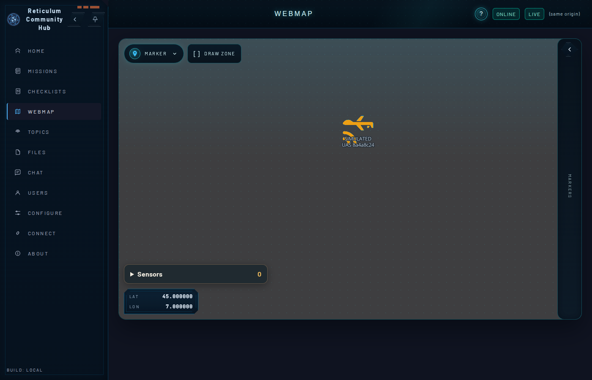
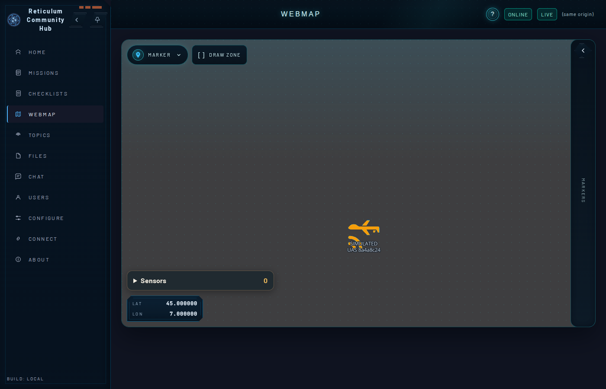

# Milestone 2a: RCH map view against RCH `cc6ca164`

Recorded 10 November 2026. This closes the one missing piece of step 2a's evidence, the RCH map view, which RCH `c2bf78a` cannot show because of G-20 ([RCH #305](https://github.com/FreeTAKTeam/Reticulum-Community-Hub/issues/305)). RCH fixed it in `cc6ca164` (merge of #306). Nothing in this repository changed for this run: the app still pins RCH `c2bf78a` and LXMF-rs `888355c` (D-1). This is a compatibility run against a newer hub, not a re-pin.

## Setup

| Part | Revision |
|---|---|
| App | `uas-sim --publish` built from `main` at `5eead21` (feature `publish`); the same store and object id as the [task 5 proof](m2a-task5-hub-host-proof.md) |
| Hub | RCH `cc6ca164a…` (separate clone), `cargo +1.89.0 build --release --locked -p r3akt-rch-server`, UI built with `npm ci && npm run build` |
| Hub daemon | LXMF-rs `9b972f9a8d3a7949eae89bc78f7a9691f06f3ed1`, the revision RCH `cc6ca164` pins |

RCH `cc6ca164` and its shared crates require Rust 1.89; this repository pins 1.88 (see G-08). The hub started with fresh state, `[hub] announce_interval = 10`, loopback ports 4243 (Reticulum TCP) and 8081 (HTTP), first-run setup completed through the API, and `mission.content.write` granted to the app destination hash `4d8ffce8db31d5f2a063a7906f46d191`.

## Result

One 240 s run. The app needed no change for the newer hub and its newer daemon.

```text
markers: 1 ['8a4a8c244ef6af1c90b1bde138447780']
writers: [('8a4a8c244ef6af1c90b1bde138447780', '4d8ffce8db31d5f2a063a7906f46d191')]
origin: 8a4a8c244ef6af1c90b1bde138447780 writer 4d8ffce8db31d5f2a063a7906f46d191 lat 45.00179617575285 lon 6.999866875011083 fixAtMs 1794333325000 kind mobile
run 1: 239 messages, first=9, field 9 at positions [0], fixes=238, repeated fixAtMs: []
signature_status: {'verified': 239}
```

`GET /api/markers` no longer carries a `stale_at` field:

```json
[{"category":"drone","created_at":"2026-11-10T17:51:27.360Z","name":"SIMULATED UAS 8a4a8c24","notes":null,"object_destination_hash":"8a4a8c244ef6af1c90b1bde138447780","origin_rch":"4d8ffce8db31d5f2a063a7906f46d191","position":{"lat":45.00179617575285,"lon":6.999866875011083},"symbol":"drone","time":"2026-11-10T17:55:25Z","type":"marker","updated_at":"2026-11-10T17:55:25Z"}]
```

## RCH map

Headless Chromium with software WebGL; the webmap opened at 45° N, 7° E, zoom 15, through the UI's own stored view (`rth-ui-map-settings`). The basemap has no detail at this zoom. The marker is drawn as the RCH `drone` symbol with the name `SIMULATED UAS 8a4a8c24`.

| Hub origin at the time | Map |
|---|---|
| lat 45.000374, lon 7.002488 (`fixAtMs 1794333232000`) |  |
| lat 44.998492, lon 6.998615 (`fixAtMs 1794333277000`), 45 s later |  |

The marker moves south across the orbit between the two page loads, as the origin does. The `Sensors` count is 0 because step 2a sends no sensor readings (field 3 waits for G-15).
