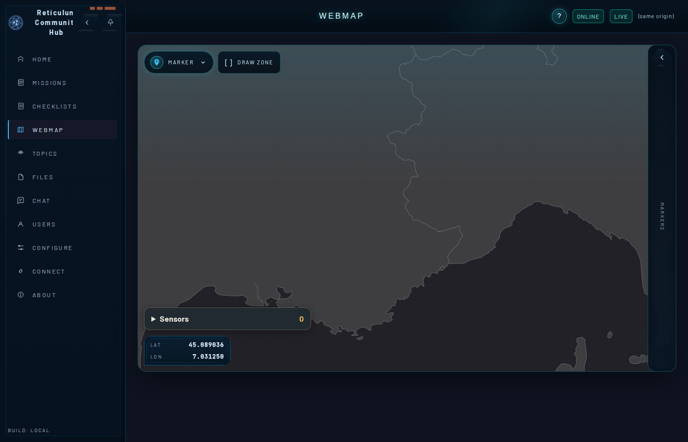

# Milestone 2a task 5: hub host proof

Recorded 10 November 2026 on the host (Linux), before the POST review that gates task 6. All addresses are loopback; the hub, its keys and its store were throwaway test state.

## Setup

| Part | Revision / command |
|---|---|
| App | `r3akt-uas` at this commit, `cargo build --release --locked -p uas-sim --features uas-sim/publish` |
| Hub | RCH `c2bf78adc2795574a5fb8c39e6cdea7e523b7ef0`, separate clone, `cargo build --release --locked -p r3akt-rch-server` |
| Hub daemon | LXMF-rs `888355c580932f886cfbf9f7076758b065a69879`, separate clone, `cargo build --release --locked -p reticulumd --bin reticulumd` |

Hub start (the hub runs the daemon itself; `[hub] announce_interval = 10` in `config.ini` so a client that connects later learns the hub's path quickly):

```bash
r3akt-rch-server --bind 127.0.0.1:8080 --db-path ./state/rch.sqlite3 --config-path ./state/config.ini \
  --api-key "$KEY" --reticulumd-exe <lxmf>/target/release/reticulumd \
  --reticulumd-db-path ./state/reticulum.db --reticulumd-transport 127.0.0.1:4242 --ui-dist-path <rch>/ui/dist
```

Hub `lxmf.delivery` destination, from `GET /api/v1/app/info` (`reticulum_destination`): `5ca609638dd20e4f677019cb688f2a93`.

## Grant

The grant takes the app's **`lxmf.delivery` destination hash** (the LXMF source hash, which is also the bound writer), not the identity hash. The app prints it as `destination_hash` before it sends anything; it was read first with `uas-sim --publish 127.0.0.1:1 …` (a closed port, nothing sent).

```bash
curl -X PUT -H "X-API-Key: $KEY" -H 'Content-Type: application/json' -d '{}' \
  http://127.0.0.1:8080/api/r3akt/capabilities/4d8ffce8db31d5f2a063a7906f46d191/mission.content.write
```

Only the field-13 origin fix needs the grant (`mission.content.write`). At `c2bf78a` the field-9 create is accepted without one because `authorization_required` is off by default; no mission or team is needed, and no field 11 is sent.

## Runs

```bash
uas-sim --publish 127.0.0.1:4242 5ca609638dd20e4f677019cb688f2a93 --store <store> --seconds N [--resend-at 20]
```

1. **First start**, ended after about 2 s when the reading pipe closed (the shared transport prints `link: close …` lines to stdout; the tool's JSON lines start with `{`). Create and the first fixes were sent.
2. **Restart**, 40 s, with `--resend-at 20`: the exact bytes of the last sent fix were sent a second time.
3. **Restart** after the hub itself was restarted, 180 s.

The app's status at the end of run 3: `state: Stopped`, `create_sent: true`, `fixes_sent: 179`, `last_error: null`, last sent fix `fix_time_s 1794328565`, lat 44.998203824247156, lon 7.000133124988917.

## Hub store after the three runs

Query (Python `sqlite3`, read-only; there is no `sqlite3` CLI on the host):

```sql
SELECT object_destination_hash FROM rch_markers;
SELECT origin_id, writer_id FROM r3s_marker_writers;
SELECT origin_id, writer_id, json FROM r3s_sensor_origins;   -- position from json
```

```text
markers: 1 ['8a4a8c244ef6af1c90b1bde138447780']
writers: [('8a4a8c244ef6af1c90b1bde138447780', '4d8ffce8db31d5f2a063a7906f46d191')]
origin: 8a4a8c244ef6af1c90b1bde138447780 writer 4d8ffce8db31d5f2a063a7906f46d191 lat 44.99820382424715 lon 7.000133124988917 fixAtMs 1794328565000 kind mobile
```

One marker and one origin for the object id after two restarts and a replayed fix; the origin holds the last fix the app sent. `GET /api/markers` returns the same single marker, named `SIMULATED UAS 8a4a8c24`, `origin_rch` = the app's destination hash, `symbol`/`category` `drone` (G-19). Verbatim `GET /api/markers` after run 3:

```json
[{"category":"drone","created_at":"2026-11-10T16:30:26.953Z","name":"SIMULATED UAS 8a4a8c24","notes":null,"object_destination_hash":"8a4a8c244ef6af1c90b1bde138447780","origin_rch":"4d8ffce8db31d5f2a063a7906f46d191","position":{"lat":44.99820382424715,"lon":7.000133124988917},"stale_at":"2026-11-10T16:36:05Z","symbol":"drone","time":"2026-11-10T16:36:05Z","type":"marker","updated_at":"2026-11-10T16:36:05Z"}]
```

`GET /Sensors` returned the origin with the moving position during run 3.

## Outgoing field trace (hub side)

From the daemon's `messages` table (`reticulum.db`), every message whose source is the app:

```text
messages from app: 224
field sets: {'9,_lxmf': 3, '13,_lxmf': 221}      # _lxmf is the daemon's own annotation, not a wire field
3 creates; identical: True                        # one per start, the stored bytes re-sent
fixes: 221 repeated fixAtMs (replays): [1794328273000]
signature_status: {'verified': 224}
```

Each message carries field 9 only or field 13 only; the create precedes the first fix in every run. The three creates are the same command (`command_id uas-create-8a4a8c244ef6af1c90b1bde138447780`), and the hub kept one marker. The daemon verified the signature of every message, because the app announces its delivery destination on each connection.

## Per-run order and movement (addendum after the POST review)

Rebuilt from the same daemon store after the runs; a gap of more than 5 s between messages starts a new run. Every run starts with the stored create, then fields 13 only; fix times never go backwards, the one repeated `fixAtMs` is the replay, and positions 10 s apart follow the orbit (course 93° → 123° → 150°).

```text
run 1: 3 messages, first=9, field 9 at positions [0], fixes=2, repeated fixAtMs: []
    fixAtMs 1794328226000 lat 45.001796 lon 7.000133 courseDeg 93.0
run 2: 41 messages, first=9, field 9 at positions [0], fixes=40, repeated fixAtMs: [1794328273000]
    fixAtMs 1794328255000 lat 45.001796 lon 7.000133 courseDeg 93.0
    fixAtMs 1794328265000 lat 45.001508 lon 7.001385 courseDeg 123.0
    fixAtMs 1794328274000 lat 45.000899 lon 7.002203 courseDeg 150.0
run 3: 180 messages, first=9, field 9 at positions [0], fixes=179, repeated fixAtMs: []
    fixAtMs 1794328387000 lat 45.001796 lon 7.000133 courseDeg 93.0
    fixAtMs 1794328397000 lat 45.001508 lon 7.001385 courseDeg 123.0
    fixAtMs 1794328407000 lat 45.000817 lon 7.002266 courseDeg 153.0
```

Marker and origin counts were captured only after all three runs, not after each one. Because the hub never deletes markers or origins in this flow, a single marker at the end means no second object was created at any point.

Scripts used (Python standard library, read-only):

```python
# store.py <rch.sqlite3>
import sqlite3, sys, json
db = sqlite3.connect(f"file:{sys.argv[1]}?mode=ro", uri=True)
q = lambda sql: db.execute(sql).fetchall()
print("markers:", q("SELECT count(*) FROM rch_markers")[0][0],
      [r[0] for r in q("SELECT object_destination_hash FROM rch_markers")])
print("writers:", q("SELECT origin_id, writer_id FROM r3s_marker_writers"))
for oid, w, j in q("SELECT origin_id, writer_id, json FROM r3s_sensor_origins"):
    p = json.loads(j).get("position") or {}
    print("origin:", oid, "writer", w, "lat", p.get("lat"), "lon", p.get("lon"), "fixAtMs", p.get("fixAtMs"), "kind", json.loads(j).get("originKind"))
```

```python
# runs.py <reticulum.db> <app destination hash>
# Per-run ordered trace of app messages in the hub daemon's store (read-only).
import json, sqlite3, sys
db, app = sys.argv[1], sys.argv[2]
c = sqlite3.connect(f"file:{db}?mode=ro", uri=True)
rows = [(ts, json.loads(f)) for ts, f in c.execute(
    "SELECT timestamp, fields FROM messages WHERE source=? ORDER BY rowid", (app,))]
runs, prev = [], None
for ts, f in rows:  # a gap of more than 5 s starts a new run
    if prev is None or int(ts) - prev > 5: runs.append([])
    runs[-1].append((int(ts), f)); prev = int(ts)
for n, run in enumerate(runs, 1):
    kinds = ["9" if "9" in f else "13" for _, f in run]
    fixes = [f["13"][0]["payload"]["position"] for _, f in run if "13" in f]
    times = [p["fixAtMs"] for p in fixes]
    print(f"run {n}: {len(run)} messages, first={kinds[0]}, field 9 at positions {[i for i, k in enumerate(kinds) if k == '9']}, "
          f"fixes={len(fixes)}, fixAtMs strictly increasing except replays: {all(b >= a for a, b in zip(times, times[1:]))}, "
          f"repeated fixAtMs: {sorted({t for t in times if times.count(t) > 1})}")
    for p in fixes[:21:10]:
        print(f"    fixAtMs {p['fixAtMs']} lat {p['lat']:.6f} lon {p['lon']:.6f} courseDeg {p['courseDeg']}")
```

## Re-run after the POST corrections

Same hub, store and object (hub restarted, default `config.ini` from above):

- Run 4, 15 s with a replay at 8 s: one marker and one origin, origin at the last sent fix (`fixAtMs 1794330582000`); the replay appears once at the hub and is no longer counted in `fixes_sent` (14). A hub hash with non-hex characters is refused before start.
- Run 4 showed a fix received **before** the create although the app sent the create first (LXMF timestamps `…569.960` create, `…570.0035` fix; daemon rows 228 and 227). Packets sent 40 ms apart can arrive reordered, and the hub silently skips a fix that precedes its create. The publisher now sends no fix in the same pass as the create, so the first fix follows one second later.
- Runs 5 and 6, 6 s each, after that change: each starts with the create (`field 9 at positions [0, 5]` in the merged trace), still one marker.

## RCH map screenshot: not obtainable at `c2bf78a` (G-20)



The webmap draws no marker here, although `/api/markers` returns it at 44.998 N, 7.000 E. At `c2bf78a` `r3akt-map-core::marker::MarkerRecord::api_value` sets `stale_at` equal to `updated_at`, and the UI drops every marker whose `stale_at` is in the past (`ui/src/stores/markers.ts` `expired`, `WebMapPage.vue` feature filter). Every marker is therefore hidden about a second after its last update, whoever created it. This is recorded as gap G-20 and reported as [RCH #305](https://github.com/FreeTAKTeam/Reticulum-Community-Hub/issues/305); the task-5 map evidence above is the store and API output instead. The screenshot was taken with headless Chromium (software WebGL) because the app's browser pane has no WebGL.

## Gaps settled by this run

- **G-17 confirmed:** `lxmf-runtime` at `888355c` exposes no inbound messages; `poll_events` returns only events the host records itself. Command results from the hub are not seen by the app.
- **G-18 confirmed from source:** the daemon annotates each message with `signature_status`; RCH at `c2bf78a` never reads it.
- **G-19 confirmed:** `uav` is stored as `drone`, origin kind `mobile`.
