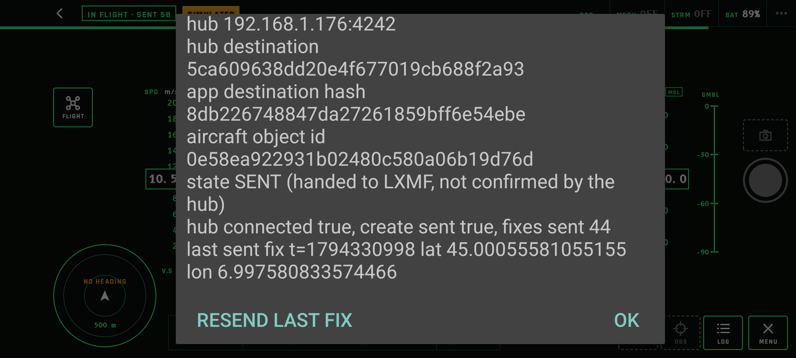
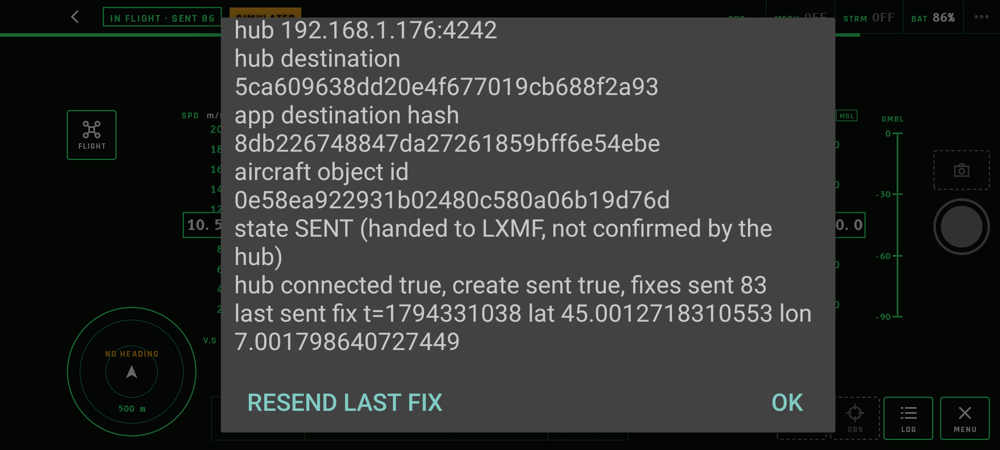

# Milestone 2a task 6: Android gate and device proof

Recorded 10 November 2026. Device: Pixel 7, Android 17, arm64-v8a, on the same Wi-Fi as the host. Hub: the throwaway RCH `c2bf78a` + `reticulumd` `888355c` of the [task 5 proof](m2a-task5-hub-host-proof.md), same state, with the Reticulum TCP port bound to the host's LAN address (`--reticulumd-transport 192.168.1.176:4242`) and `[hub] announce_interval = 10`. Device and host clocks agreed to the second (`date +%s`).

## Build gate (D-4, UAS-SCF-005)

| Build | Variants enabled | Publisher in `libr3akt_uas_app.so` | `INTERNET` |
|---|---|---|---|
| default (`./gradlew :app:assembleSimDebug :app:assembleDji4Debug`) | `sim`, `dji4` | no (`uniffi_r3akt_uas_app_fn_func_publish` absent, both ABIs) | `sim`: no; `dji4`: yes (DJI registration) |
| `-Pr3aktPublish=true -Pr3aktHubAddress=… -Pr3aktHubDestination=…` | `simNet` only | yes | yes |

The `ci` workflow builds the default variants only and fails if either default APK's native library contains a `publish` symbol, or if the `sim` APK requests `INTERNET`. Both checks were run locally against the default APKs (pass) and against the `simNet` APK renamed as `sim` (fail, as intended). The hub address and destination are Gradle properties given on the command line or in `~/.gradle/gradle.properties`, never in the repository.

## Operator flow

Publishing starts only on the operator's tap: **LOG → START PUBLISH**. While it runs the same button reads **RESEND LAST FIX**; leaving the cockpit (Home, another app, force-stop) stops it, off the main thread. The HUD status shows `IN FLIGHT · SENT n`; the session log shows the hub, the app's destination hash, the object id, the state ("handed to LXMF, not confirmed by the hub"), the counts and the last sent fix.

The phone has its own identity (`8db226748847da27261859bff6e54ebe`) and aircraft object (`0e58ea922931b02480c580a06b19d76d`), separate from the host tool's. Its first create reached the hub before the grant (the create needs none at `c2bf78a`); its fixes were skipped until the grant below and applied from then on.

```bash
curl -X PUT -H "X-API-Key: $KEY" -H 'Content-Type: application/json' -d '{}' \
  http://127.0.0.1:8080/api/r3akt/capabilities/8db226748847da27261859bff6e54ebe/mission.content.write
```

| Step | App | Hub |
|---|---|---|
| After launch and START PUBLISH |  | marker `0e58ea92…` created; origin appears after the grant |
| After RESEND LAST FIX |  | `fixAtMs 1794331024000` received twice; no second object |
| After force-stop, relaunch and START PUBLISH |  | same destination hash and object id; the stored create re-sent first; still one marker |
| Home pressed at `1794331105` | — | last message `1794331104`; none afterwards |

## Hub store and trace after the device runs

Same scripts as task 5 (`store.py`, `runs.py`, `trace.py`).

```text
markers: 2 ['0e58ea922931b02480c580a06b19d76d', '8a4a8c244ef6af1c90b1bde138447780']
writers: [('8a4a8c…', '4d8ffce8…'), ('0e58ea922931b02480c580a06b19d76d', '8db226748847da27261859bff6e54ebe')]
origin: 0e58ea922931b02480c580a06b19d76d writer 8db226748847da27261859bff6e54ebe lat 44.99824066388786 lon 7.000528857090283 fixAtMs 1794331104000 kind mobile

messages from app: 128
field sets: {'9,_lxmf': 2, '13,_lxmf': 126}
fixes: 126 repeated fixAtMs (replays): [1794331024000]
signature_status: {'verified': 128}
run 1: 89 messages, first=9, field 9 at positions [0], fixes=88, repeated fixAtMs: [1794331024000]
    fixAtMs 1794330954000 lat 44.998321 lon 7.000912 courseDeg 249.0
    fixAtMs 1794330964000 lat 44.998224 lon 6.999602 courseDeg 279.0
    fixAtMs 1794330974000 lat 44.998602 lon 6.998399 courseDeg 309.0
run 2: 39 messages, first=9, field 9 at positions [0], fixes=38, repeated fixAtMs: []
    fixAtMs 1794331066000 lat 45.000980 lon 7.002133 courseDeg 147.0
    fixAtMs 1794331076000 lat 45.000094 lon 7.002540 courseDeg 177.0
    fixAtMs 1794331087000 lat 44.999183 lon 7.002266 courseDeg 207.0
```

The second marker is the host tool's aircraft from task 5 (another identity), not a duplicate. Verbatim `GET /api/markers` entry for the phone's aircraft; its position equals the last origin fix:

```json
{"category": "drone", "created_at": "2026-11-10T17:15:53.545Z", "name": "SIMULATED UAS 0e58ea92", "notes": null, "object_destination_hash": "0e58ea922931b02480c580a06b19d76d", "origin_rch": "8db226748847da27261859bff6e54ebe", "position": {"lat": 44.99824066388786, "lon": 7.000528857090283}, "stale_at": "2026-11-10T17:18:24Z", "symbol": "drone", "time": "2026-11-10T17:18:24Z", "type": "marker", "updated_at": "2026-11-10T17:18:24Z"}
```

## Not shown

- An RCH map screenshot: the hub's webmap hides every marker at `c2bf78a` (G-20, [RCH #305](https://github.com/FreeTAKTeam/Reticulum-Community-Hub/issues/305)).
- REM (step 2b), RNode, a real DJI source, and any behaviour while the cockpit is in the background (publishing stops there by design).
