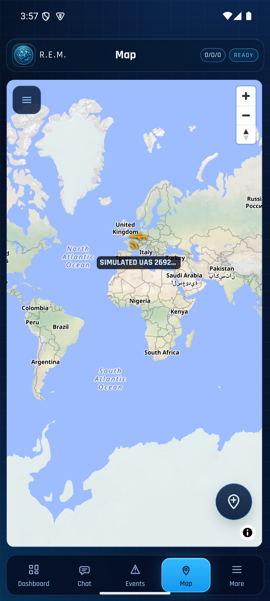
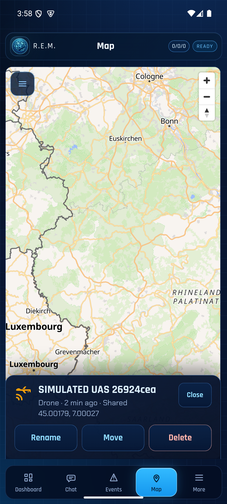

# Milestone 2b task 0: REM relay spike

Recorded 10 November 2026 on the owner's machine by the agent. No code in this repository changed. The publisher was a throwaway build of `uas-sim` from a scratch worktree pinned to RCH `f5822210` and LXMF-rs `9b972f9a`. In that build `fix_message` called the shared `r3akt_map_core::sensor_wire::encode_object_fields(object_id, Some(&position), &[], Some(team))` when `SPIKE_TEAM` was set. The build was not committed.

**Result: REM shows the aircraft once, from a team-relayed object message, with REM unchanged. The stop rule does not apply.**

## Setup

| Part | Revision / setting |
|---|---|
| Hub | RCH `f5822210` (`cargo +1.89.0 build --release --locked -p r3akt-rch-server`); fresh database; Reticulum TCP `127.0.0.1:4244`, HTTP `127.0.0.1:8082`; `[hub] announce_interval = 10` |
| Hub daemon | `reticulumd` from LXMF-rs `9b972f9a` |
| REM | `0cfa422` (1.6.1), built from a clean clone following its CI: LXMF-rs `8c27a200` as a sibling, `npm ci`, `npm run mobile:build`, `npx cap sync android`, `cargo +1.99.1 build --target x86_64-linux-android`, `ANDROID_HOME=… ./gradlew :app:assembleDebug` |
| REM device | Android emulator, x86_64, API 35, portrait. In landscape the setup wizard's fixed header leaves too little room to reach the TCP field. |
| REM settings | Setup wizard: one TCP endpoint `10.0.2.2:4244` (all community servers unchecked; the default `134.122.46.48:37428` was removed); routing **Connected**, hub `d4f4180cfbfc16d00b52e8408f1a9281`; location and SOS off |
| Publisher | fresh store; delivery hash `170914f60e71dd664b051c329b1a88df`, object `26924ceabe344616faffab41ce578c37`; 120 s of orbit at 1 Hz, wall-clock fix times |

REM's "Hub identity hash" field takes the hub's **`lxmf.delivery`** hash, which is what REM stores when it picks a hub from heard announces. REM announced as destination `23f92b3d92d817f9b83a491f09af9e91` with capabilities `r3akt`, `emergencymessages`, `telemetry`, `rem.standard_lxmf_receipts.v1`. The hub recorded `client_type` `rem` and `announced_identity_hash` empty, which confirms that membership uses delivery hashes.

## Hub setup (all calls with header `X-API-Key`)

```bash
# The canonical team must be created by UID; {"color":"BLUE"} alone creates a team with a random UID (G-21).
curl -X POST  $HUB/api/r3akt/teams        -d '{"uid":"43341e5c822d99857fa6e8641f2ca9c0"}'
curl -X POST  $HUB/api/r3akt/team-members -d '{"team_uid":"43341e5c822d99857fa6e8641f2ca9c0","rns_identity":"170914f60e71dd664b051c329b1a88df","display_name":"R3AKT UAS spike"}'
curl -X POST  $HUB/api/r3akt/team-members -d '{"team_uid":"43341e5c822d99857fa6e8641f2ca9c0","rns_identity":"23f92b3d92d817f9b83a491f09af9e91","display_name":"REM Beta526"}'
curl -X PUT   $HUB/api/r3akt/capabilities/170914f60e71dd664b051c329b1a88df/mission.content.write -d '{}'
```

`rns_identity` is the **delivery hash** for both members, and the grant also takes the publisher's delivery hash.

## What the hub relayed to REM

From the daemon's outgoing `messages` (fields are base64 MessagePack there; script `relays.py` below):

```text
R3S relays to REM: 118 | other messages: {'10': 6}
first relay fields ['13', '3'] events ['mission.registry.sensor_origin.assert', 'mission.marker.created', 'mission.registry.origin.telemetry.upsert']
relays carrying mission.marker.created: 1
   t 1794340578 SIMULATED UAS 26924cea lat 45.00178878758535 lon 7.000265885091492 fixAtMs 1794340578000 receipt delivered
```

- **Relays:** the hub sent REM 118 R3S relays. Only the first carried `mission.marker.created`. After its delivery was confirmed, the hub stored the relay metadata (`r3s_relay_metadata`: one row for the object and REM), and the other 117 carried only the field-3 stream and the origin fix.
- **Other messages:** the six field-10 messages are hub-directory command results unrelated to the relay. For example, before the team existed one said "REM announce capabilities are required".
- **Rejected dispatches:** none were seen. The hub's `rch_messages` table shows 95 `delivered` and 1 `sending`, all `accepted`.

## Hub and REM side by side

| | Position | Time |
|---|---|---|
| Relayed `mission.marker.created` | 45.001789, 7.000266 | `fixAtMs 1794340578000` (first fix) |
| REM marker detail | **45.00179, 7.00027**, "Drone · Shared", named `SIMULATED UAS 26924cea` | shown 2 min after the first relay |
| Hub origin at the end | 45.001796, 6.999867 | `fixAtMs 1794340695000` (last of 118 fixes) |

REM's map menu reports "Markers: 1, shown". The hub store has one marker and one origin, with the publisher as bound writer.





REM shows the aircraft **once**, at the position relayed with the marker metadata. It does not follow the orbit, because REM ignores the origin fixes ([REM #341](https://github.com/FreeTAKTeam/reticulum_mobile_emergency_management/issues/341), C-REM-3). This is the outcome D-6 accepted.

## Script

```python
# relays.py <reticulum.db> <REM destination>: R3S relays the hub sent to one REM.
import sqlite3, sys, json, collections, base64, msgpack
c = sqlite3.connect(f"file:{sys.argv[1]}?mode=ro", uri=True)
rows = c.execute("select timestamp, fields, receipt_status from messages where destination=? and direction='out' order by rowid", (sys.argv[2],)).fetchall()
relays, meta, other = 0, [], collections.Counter()
for ts, f, rs in rows:
    f = json.loads(f) if f else {}
    if "_lxmf_fields_msgpack_b64" in f:
        raw = msgpack.unpackb(base64.b64decode(f["_lxmf_fields_msgpack_b64"]), raw=False, strict_map_key=False)
        f = {str(k): v for k, v in raw.items()}
    ev = f.get("13")
    if not isinstance(ev, list):
        other[next(iter(f.keys()), "-")] += 1
        continue
    relays += 1
    kinds = [e.get("event_type") for e in ev if isinstance(e, dict)]
    mk = [e for e in ev if isinstance(e, dict) and e.get("event_type") == "mission.marker.created"]
    fix = [e["payload"]["position"]["fixAtMs"] for e in ev if isinstance(e, dict) and e.get("event_type") == "mission.registry.origin.telemetry.upsert"]
    if relays == 1: print("first relay fields", sorted(f.keys()), "events", kinds)
    if mk:
        p = mk[0]["payload"]
        meta.append((int(ts), p.get("name"), p["position"]["lat"], p["position"]["lon"], fix[0] if fix else None, rs))
print("R3S relays to REM:", relays, "| other messages:", dict(other))
print("relays carrying mission.marker.created:", len(meta))
for m in meta: print("   t", m[0], m[1], "lat", m[2], "lon", m[3], "fixAtMs", m[4], "receipt", m[5])
```
