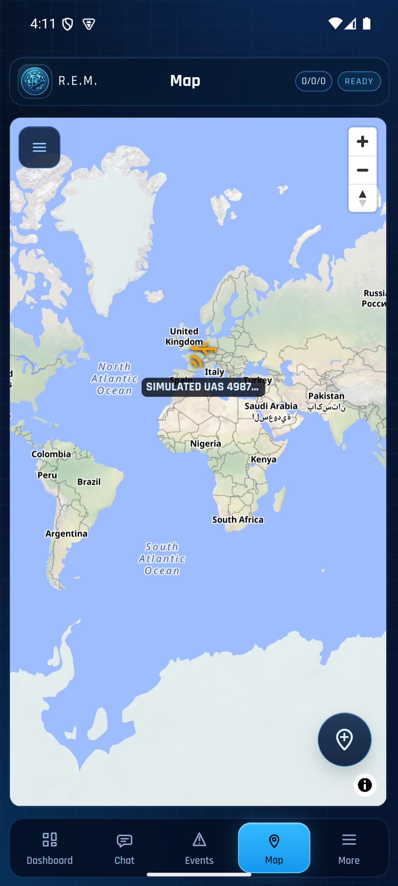
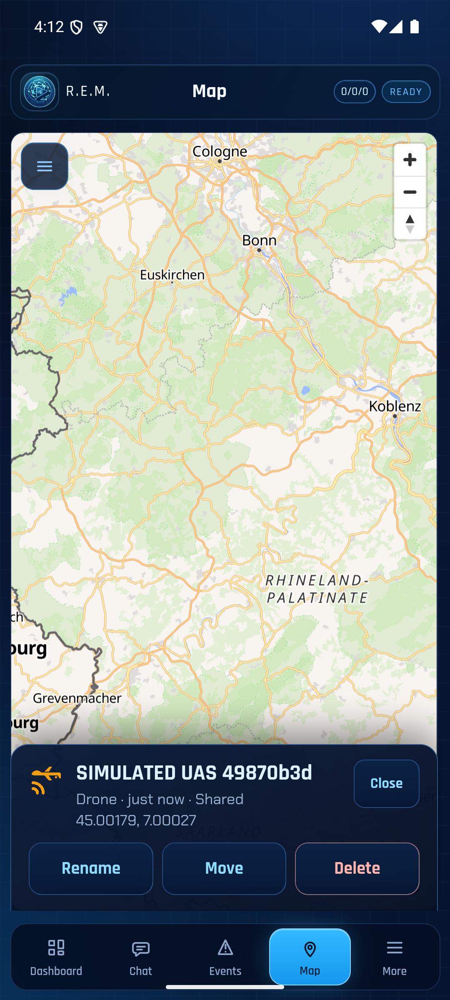
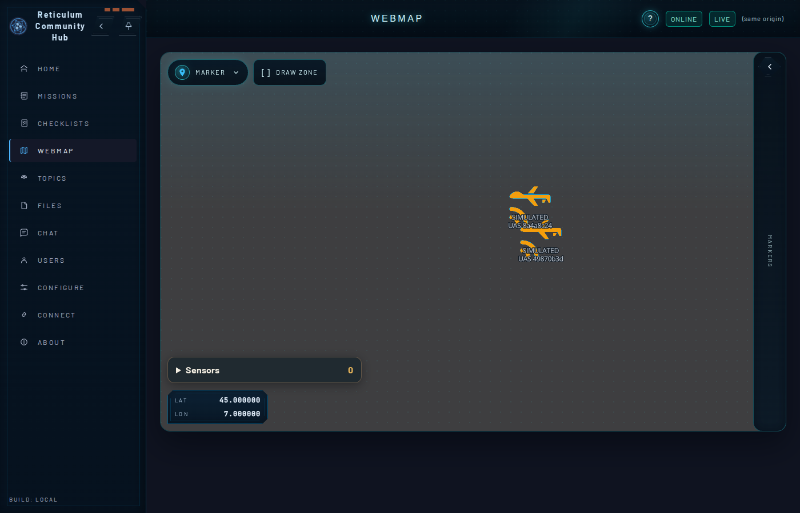

# Milestone 2b task 3: host proof with REM

Recorded 10 November 2026 by the agent on the owner's machine. The publisher is `uas-sim --publish --team`, built from this repository at `96ec388` (RCH `f5822210`, LXMF-rs `9b972f9a`, Rust 1.89). The hub, its daemon and REM are the same builds as in the [task 0 spike](m2b-task0-rem-relay-spike.md).

**Result:** REM shows one marker per aircraft, at the position the hub relayed with the marker metadata, through a publisher restart, a replayed fix and a REM force-stop and relaunch. On RCH the aircraft keeps one marker and one origin, and the RCH map draws it at its latest position. **REM does not follow the orbit** (D-6, [REM #341](https://github.com/FreeTAKTeam/reticulum_mobile_emergency_management/issues/341)).

## State (D-8)

| Part | State |
|---|---|
| Hub | RCH `f5822210` with `reticulumd` LXMF-rs `9b972f9a`; **fresh database**; Reticulum TCP `127.0.0.1:4246`, HTTP `127.0.0.1:8084`; `[hub] announce_interval = 10`; hub `lxmf.delivery` `44f1b6fb7a69f3d06db9b58793bfebac` |
| REM | `0cfa422` on the x86_64 API 35 emulator, **app data cleared** (`pm clear`) and set up again: TCP `10.0.2.2:4246` only, Connected, hub `44f1b6fb…`, location and SOS off. New REM delivery hash `9d1a1963c3e150156227425482e695a9` (call sign Sigma633), announced with `client_type` `rem`. |
| App | **fresh store**: delivery hash `a8e4643c7f217de46e01f654fc12ece3`, object `49870b3d8cfc0221dfc8b1a16a5da1cd`; then the **2a store** (`4d8ffce8db31d5f2a063a7906f46d191`, object `8a4a8c244ef6af1c90b1bde138447780`) |
| Mixed revisions | REM is built on LXMF-rs `8c27a200` (REM's own pin, two commits before `9b972f9a`); hub, daemon and app use `9b972f9a` |

## Hub setup (header `X-API-Key`)

```bash
curl -X POST $HUB/api/r3akt/teams        -d '{"uid":"43341e5c822d99857fa6e8641f2ca9c0"}'      # BLUE, by UID (G-21)
curl -X POST $HUB/api/r3akt/team-members -d '{"team_uid":"43341e5c822d99857fa6e8641f2ca9c0","rns_identity":"9d1a1963c3e150156227425482e695a9","display_name":"REM Sigma633"}'
curl -X POST $HUB/api/r3akt/team-members -d '{"team_uid":"43341e5c822d99857fa6e8641f2ca9c0","rns_identity":"a8e4643c7f217de46e01f654fc12ece3","display_name":"R3AKT UAS host"}'
curl -X PUT  $HUB/api/r3akt/capabilities/a8e4643c7f217de46e01f654fc12ece3/mission.content.write -d '{}'
# the 2a store: same two calls with 4d8ffce8db31d5f2a063a7906f46d191
```

## Runs

```bash
uas-sim --publish 127.0.0.1:4246 44f1b6fb7a69f3d06db9b58793bfebac --store <fresh> --team 43341e5c822d99857fa6e8641f2ca9c0 --seconds 60 --resend-at 30
uas-sim --publish 127.0.0.1:4246 44f1b6fb7a69f3d06db9b58793bfebac --store <fresh> --team 43341e5c822d99857fa6e8641f2ca9c0 --seconds 30   # restart
# then REM force-stop and relaunch
uas-sim --publish 127.0.0.1:4246 44f1b6fb7a69f3d06db9b58793bfebac --store <2a store> --team 43341e5c822d99857fa6e8641f2ca9c0 --seconds 20
```

Hub trace for the fresh store (scripts `store.py` and `runs.py` from the [task 5 proof](m2a-task5-hub-host-proof.md); `relays.py` from the [spike](m2b-task0-rem-relay-spike.md)):

```text
run 1: 60 messages, first=9, field 9 at positions [0], fixes=59, repeated fixAtMs: [1794341486000]   # the replay
run 2: 29 messages, first=9, field 9 at positions [0], fixes=28, repeated fixAtMs: []                # the restart
markers: 1 ['49870b3d8cfc0221dfc8b1a16a5da1cd']
origin: 49870b3d… writer a8e4643c… lat 45.00009413358241 lon 7.0025401761100765 fixAtMs 1794341556000 kind mobile

R3S relays to REM: 86 | other messages: {'10': 8}
relays carrying mission.marker.created: 1
   t 1794341459 SIMULATED UAS 49870b3d lat 45.00178878758535 lon 7.000265885091492 fixAtMs 1794341459000 receipt delivered
```

The fix messages carry fields 3, 11 and 13 (task 2). No relay dispatch was rejected: every outgoing relay reached `delivered` or was still `sending`, and none stayed queued.

## REM

| Moment | REM |
|---|---|
| During run 1 | map menu "Markers: 1, shown"; detail card `SIMULATED UAS 49870b3d`, **45.00179, 7.00027** (the relayed metadata position, first fix) |
| After run 2 (restart) and the replay | unchanged |
| After REM force-stop and relaunch | "Markers: 1, shown". On relaunch REM asked for the notification permission, which was declined. |
| After the 2a-store run | "Markers: 2, shown": the second marker is the other aircraft `8a4a8c24`, relayed once with metadata at its first fix |





At the same time the hub origin had moved to 45.000094, 7.002540 (`fixAtMs 1794341556000`). REM keeps the first relayed position; this is "appearance only" (D-6).

## 2a store against the 2b hub

The stored step 2a create bytes were accepted on the fresh hub, and the object message with the team applied.

```text
run 1: 19 messages, first=9, field 9 at positions [0], fixes=18
markers: 2 ['49870b3d8cfc0221dfc8b1a16a5da1cd', '8a4a8c244ef6af1c90b1bde138447780']
origin: 8a4a8c24… writer 4d8ffce8… lat 45.000979609950136 lon 7.002133294546954 fixAtMs 1794341736000 kind mobile
   t 1794341719 SIMULATED UAS 8a4a8c24 lat 45.00178878758535 lon 7.000265885091492 fixAtMs 1794341719000 receipt delivered
```

Two identities give two aircraft objects. That is expected and not a duplicate: each identity has one marker and one origin.

## RCH compared with step 2a

- **Store and `/Sensors`:** one marker and one origin per object, `originKind` `mobile` (G-19), `sensors` empty, label `SIMULATED UAS …`. The shared encoder's field-3 stream (no sensors) is not stored.
- **RCH map:** both aircraft are drawn at their latest positions, as at `cc6ca164` in step 2a.


