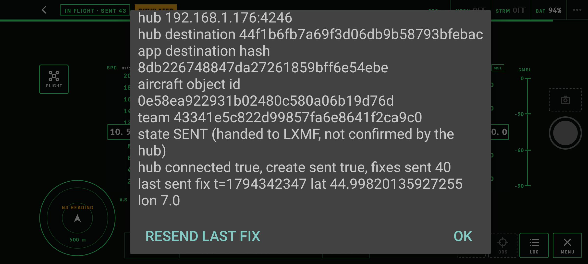
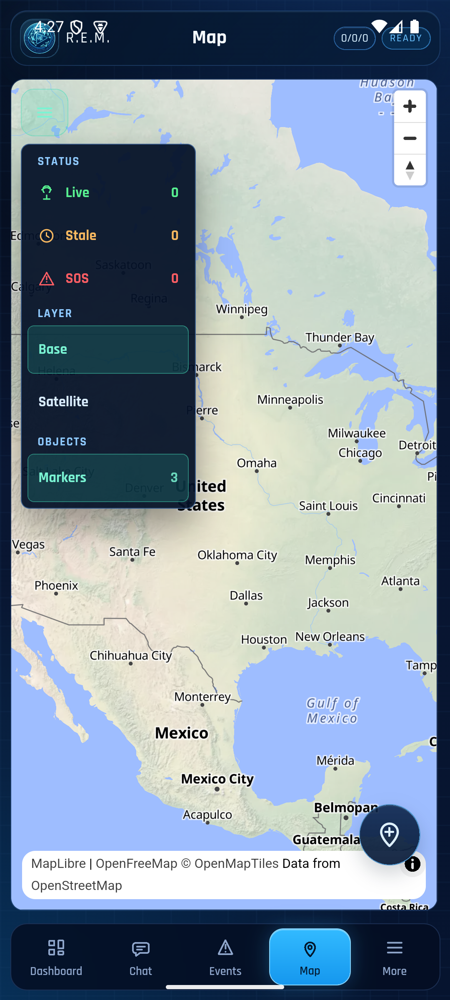

# Milestone 2b task 4: simNet device proof with REM

Recorded 10 November 2026 by the agent on the owner's machine.
- **Publisher:** the `simNet` test build on the Pixel 7 (Android 17), built from this repository with the team property.
- **Hub:** the [task 3](m2b-task3-host-proof-rem.md) hub (RCH `f5822210`, its database kept), with its Reticulum port now bound to `0.0.0.0:4246`, so the Pixel reaches it at `192.168.1.176:4246` and the emulator at `10.0.2.2:4246`.
- **REM:** the task 3 install (`0cfa422`, Sigma633, `9d1a1963c3e150156227425482e695a9`) on the emulator.

**Result:** the Pixel's aircraft appears once in REM, at the position the hub relayed with the marker metadata. On RCH it keeps one marker and one origin through a replay, a force-stop and relaunch, and the cockpit leaving the foreground. REM does not follow the orbit (D-6, [REM #341](https://github.com/FreeTAKTeam/reticulum_mobile_emergency_management/issues/341)).

## Build and setup

```bash
./gradlew -Pr3aktPublish=true -Pr3aktHubAddress=192.168.1.176:4246 \
  -Pr3aktHubDestination=44f1b6fb7a69f3d06db9b58793bfebac \
  -Pr3aktTeamUid=43341e5c822d99857fa6e8641f2ca9c0 :app:assembleSimNetDebug
```

- **App identity:** installed over the step 2a test build, so the app kept its identity: delivery hash `8db226748847da27261859bff6e54ebe`, object `0e58ea922931b02480c580a06b19d76d`.
- **Clocks:** Pixel `1794342270`, host `1794342269`.
- **Hub setup:** the Pixel's delivery hash was added to BLUE and granted, with the same calls as in task 3.
- **Default builds:** `sim` and `dji4` were built again without the property, and the CI assertions still pass.

## Pixel 7



| Step | Hub |
|---|---|
| LOG → START PUBLISH | create first; marker `0e58ea92` created; relayed to REM once with `mission.marker.created` at 45.00081656580271, 7.002266419535871 (`fixAtMs 1794342307000`, delivered) |
| RESEND LAST FIX | `fixAtMs 1794342370000` received twice; no second object |
| force-stop, relaunch, START PUBLISH | the stored create first again; same destination hash and object |
| Home at `1794342408` | last message from the Pixel `1794342408`; none after |

```text
run 1: 67 messages, first=9, field 9 at positions [0], fixes=66, repeated fixAtMs: [1794342370000]
run 2: 20 messages, first=9, field 9 at positions [0], fixes=19, repeated fixAtMs: []
markers: 3 ['0e58ea92…', '49870b3d…', '8a4a8c24…']   # one per identity (Pixel, task 3 host store, 2a host store)
origin: 0e58ea92… writer 8db22674… lat 45.0 lon 7.002543662110595 fixAtMs 1794342408000 kind mobile
```

## REM

REM's map menu shows "Markers 3", one per aircraft:



This is REM's own marker store (`files/reticulum-mobile/app_state.db`, table `rch_markers`). It was copied from the debug build with `run-as`; the identity file beside it was not read.

```text
49870b3d… SIMULATED UAS 49870b3d  45.00178878758535, 7.000265885091492  origin_rch a8e4643c…  (task 3 host store)
8a4a8c24… SIMULATED UAS 8a4a8c24  45.00178878758535, 7.000265885091492  origin_rch 4d8ffce8…  (2a host store)
0e58ea92… SIMULATED UAS 0e58ea92  45.00081656580271, 7.002266419535871  origin_rch 8db22674…  (Pixel 7)
```

Each REM marker equals the position in the one relay that carried `mission.marker.created` for that object. The hub origin of the Pixel aircraft had moved on to 45.0, 7.002544 by the end; REM's marker stays put (appearance only).
