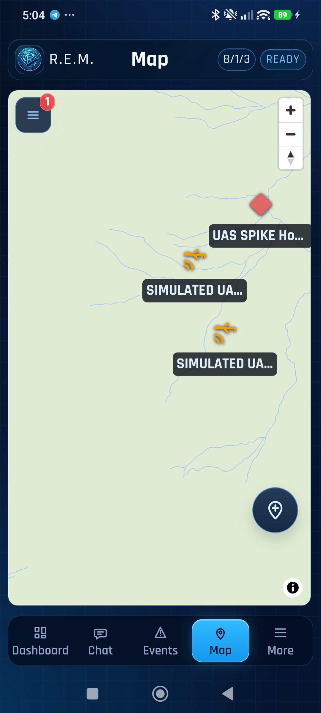

# Operator markers, task 0: app-placed marker reaches REM (spike)

Recorded 10 November 2026 by the agent on the owner's machine. Nothing in this repository changed. The publisher was a throwaway build of `uas-sim` from a scratch worktree of `feat/m3-markers` (RCH `f5822210`, LXMF-rs `9b972f9a`), which was not committed. At second 5 it sent one ordinary marker, built the way REM `0cfa422` builds its own markers (`node/map_marker_replication.rs`):

- **Record:** shared `r3akt_map_core::MarkerDraft` and `MarkerRecord::create`, symbol `hostile` (NATO affiliation set).
- **Command:** a mission-command `mission.marker.create`.
- **Message:** shared `r3akt_map_core::marker_wire::encode_fields("mission.marker.created", …)`, giving fields 3, 9 and 13.

The setup was the hub and team from the [task 3](m2b-task3-host-proof-rem.md) and [task 4](m2b-task4-device-proof.md) proofs: RCH `f5822210`, team BLUE. The publisher was the host store `a8e4643c…`, a BLUE member with a grant. REM ran on two devices in BLUE: the emulator (`9d1a1963…`) and the owner's Poco (`4d30bc17…`, reached over USB with `adb reverse tcp:4246 tcp:4246` because it is on another Wi-Fi network).

## Result

| Run | Message | RCH | REM |
|---|---|---|---|
| Hostile-1, Hostile-2 | fields 3, 9, 13 (no team) | marker created at 45.004, 7.004, `origin_rch` = the app | **not relayed** to either REM |
| Hostile-3 | the same, plus field 11 = BLUE | marker created | relayed to both REMs as `mission.marker.created` (fields 10, 11, 13), receipt `delivered`; the Poco draws a red hostile diamond "UAS SPIKE Hostile-3" |

RCH fans a command out to the team only when it carries `_rem_team_uid`, which `r3akt-transport-rns/src/direct_lxmf.rs:92` sets from field 11 (`durable_broker/envelope.rs` around line 239). Without field 11 the response goes back to the sender only.

## Consequences for the plan

- **Shared builder:** the marker message must carry field 11. The shared `encode_fields` has no team parameter, so this repository cannot add it without writing wire code. That is requested in [RCH #314](https://github.com/FreeTAKTeam/Reticulum-Community-Hub/issues/314), with this finding added as a comment.
- **REM's own markers:** REM's own `MapMarkerChange` path does not add field 11 either, so REM's markers sent to the hub may not reach the rest of the team. That is for the REM side to check.
- **This spike's shortcut:** it appended field 11 by editing the MessagePack map by hand. That is acceptable for a throwaway spike only, never in the product.
