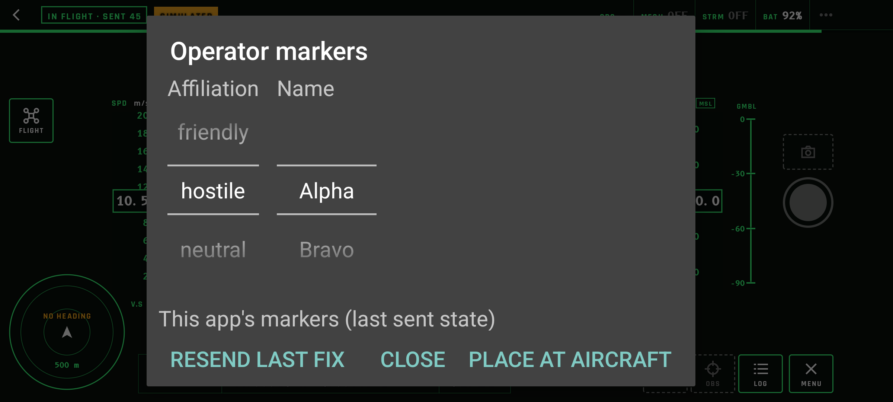
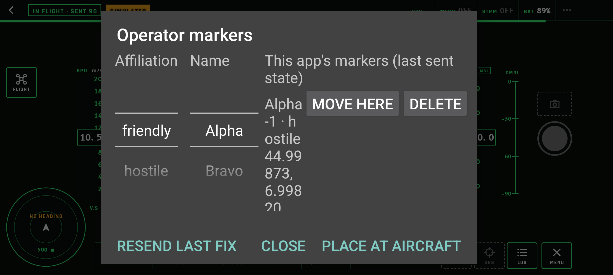
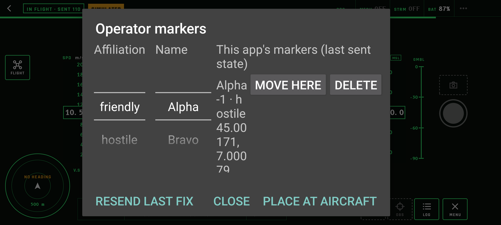
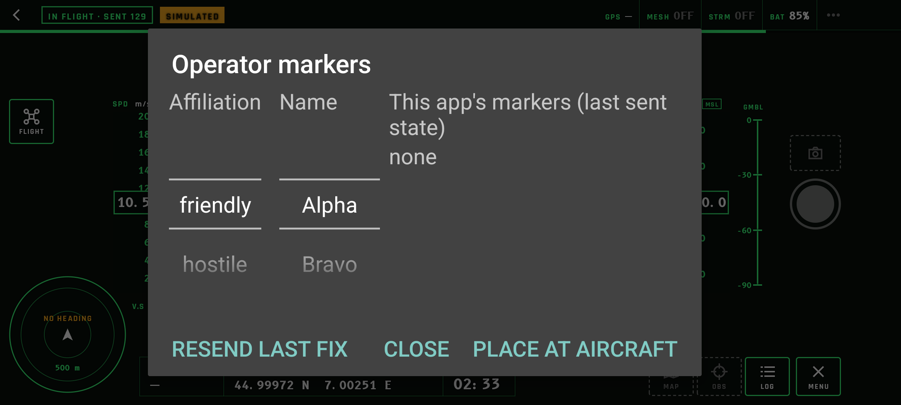

# Operator markers, tasks 3 and 4: marker changes, custody outbox and placement UI

Recorded 10 November 2026 for branch `feat/m3-markers`.
- **Built ahead of RCH #315 (D-13):** marker commands use the shared `r3akt_profile_rch::encode_commands`, field 9 only. They therefore reach **RCH but not yet REM**. When #315 is pinned, only the encoder call in `markers::message` changes (the `shortcut:` comment marks it); nothing in this repository writes field 11.
- **Test setup:** hub RCH `f5822210` with team BLUE; publishers are the host store `a8e4643c…` and the Pixel 7 `8db22674…`, both BLUE members with a grant.

## What was built

- **`markers.rs`:**
  - shared `MarkerDraft`/`MarkerRecord`, with NATO affiliation symbols (D-11);
  - mission commands `mission.marker.create`, `.position.patch` and `.delete`, each with a fixed `command_id` per stored message, encoded by the shared encoder;
  - the app's own list (last sent state) in the shared map-core marker store (`own-markers.sqlite`);
  - labels "SIMULATED ·" and "at aircraft position" (D-10, D-11).
- **`publish.rs`:**
  - the LXMF-rs custody outbox `LocalPropagation` (`outbox.sqlite`) next to the in-process backend;
  - marker changes deposited at once, connected or not (create as `Application`; moves and delete share the key `marker:<id>`);
  - on each connected pass the worker remembers the hub's identity and recovers only the **oldest** pending change, as a Resource, so delivery is recorded without a receive path;
  - `PublishStatus.markers_pending`.
- **UniFFI:** `marker_create`, `marker_move`, `marker_delete` and `marker_list`. Each returns once the outbox holds the change; it refuses when publishing is off, the aircraft position is unknown or the name is empty.
- **simNet:**
  - `MarkerPanel`, adapted from the FreeTAKUAS GeoObject popup (affiliation picker, Alpha–Zulu name with a counter), opened by the session log's MARKERS button while publishing;
  - PLACE AT AIRCRAFT, and for each own marker MOVE HERE and DELETE.

  The single `main` hook (`logAction`) now passes the cockpit Activity.
- **Build:**
  - `lxmf-propagation` (LXMF-rs `9b972f9a`, shared allowlist, D-12), `rusqlite` and map-core `sqlite`, all under `publish` only;
  - CI also refuses `marker_` symbols in default APKs. The default `sim` and `dji4` libraries contain none (checked locally).

## Host runs (`uas-sim --mark-at/--move-at/--delete-at`)

| Run | Hub | Result |
|---|---|---|
| A: create at 5 s, move at 15 s, delete at 30 s | up | the hub received create, position.patch and delete once each, in order; command ids `uas-marker-create-c79a4f64…`, `uas-marker-move-…`, `uas-marker-delete-…`; notes "SIMULATED · at aircraft position" |
| B: create at 3 s | **down** | `markers_pending: 1` (deposited offline; the outbox remembered the hub's identity) |
| C: no new marker, hub restarted | up | the pending create was delivered; the hub shows "UAS Alpha-1" (hostile) |

## Pixel 7 (simNet, through the UI)

| Step | Pixel | Hub |
|---|---|---|
| hostile, Alpha → PLACE AT AIRCRAFT |  | "Alpha-1", hostile, at the aircraft position, `origin_rch` = the Pixel, notes "SIMULATED · at aircraft position" |
| list |  | — |
| MOVE HERE |  | position 45.00171, 7.00079 |
| DELETE |  | marker absent |

```text
hub received 1794349727 mission.marker.create
hub received 1794349895 mission.marker.position.patch
hub received 1794349915 mission.marker.delete
```

## Not yet shown

- **REM:** REM receives the markers only after RCH #315, which brings field 11 through the shared encoder (relay to REM proven in the [task 0 spike](m3-task0-marker-relay-spike.md)).
- **Task 5 proof:** create, move and delete on REM; replay orders; an offline change on the device. Then the POST review.
